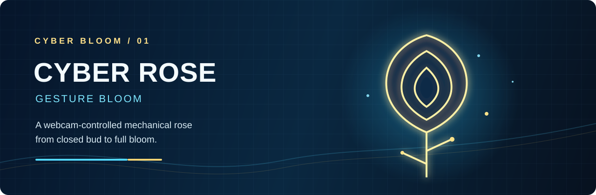

<div align="center">



# Cyber Rose · Gesture Bloom

### Webcam-controlled blue-gold mechanical rose


*Open your hand. Awaken the blue-gold core.*

</div>

## 项目简介

Cyber Rose Gesture Bloom 是一个浏览器里的机械玫瑰互动展示。它通过摄像头读取一只手的张合状态，把玫瑰从闭合花苞、微张、半开逐步过渡到灿烂盛放，再随着握拳自然收拢。

设计重点不是突然切换几张图片，而是使用六阶段图像、相邻阶段交叉淡化和弹簧缓冲，让花瓣产生更柔和、更像真实花朵的开合过程。

## 核心能力

- 单手摄像头识别，支持握拳到张掌的连续控制
- 六阶段机械玫瑰：从 bud 到 full bloom 的平滑过渡
- 相邻阶段交叉淡化，避免“几张照片跳来跳去”
- 蓝金科技花瓣、光晕、粒子和轻微动势
- 摄像头重试、全屏、重置和键盘备用控制
- 摄像头与识别在浏览器端运行，适合本地演示和 OBS 录制

## 效果预览

<div align="center">


</div>

## 使用方式

1. 双击 `start.bat`，或在此文件夹运行 `node server.mjs --open`。
2. 在 Chrome 或 Edge 打开 `http://127.0.0.1:4173/`。
3. 允许摄像头权限。
4. 先握拳，再慢慢张开手掌，观察玫瑰开合。

不要直接双击 `index.html`。摄像头权限需要通过本地服务器页面访问。

## OBS 录制建议

请在普通 Chrome/Edge 窗口打开网页，再使用 OBS 的“窗口采集”或“显示器采集”。不建议把需要调用摄像头的页面直接放进 OBS 的“浏览器”来源，因为嵌入页面可能无法稳定获得摄像头权限。

## 摄像头故障排查

- 关闭 Douyin、微信、视频会议软件、OBS 摄像头来源和重复网页。
- 页面提示占用时，先释放摄像头，再点击 **Retry Camera**。
- 如果一直停留在模型加载，刷新一次并确认浏览器能访问 MediaPipe CDN 和模型地址。

## Skill 使用示例

```text
Use the cyber-rose-gesture-bloom skill to improve the mechanical rose's hand-controlled opening and closing while preserving the six-stage visual sequence.
```

## 项目结构

| 路径 | 内容 |
| --- | --- |
| `SKILL.md` | 可复用的 Codex Skill 说明 |
| `assets/` | 机械玫瑰阶段图、GitHub 横幅和预览图 |
| `src/` | 手势识别、动画、状态、摄像头和粒子逻辑 |
| `tests/` | Node 测试 |
| `start.bat` / `server.mjs` | 本地启动服务 |

## 测试

```powershell
node --test
```

## License

MIT License，详见 [LICENSE](LICENSE)。
